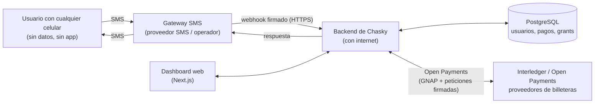
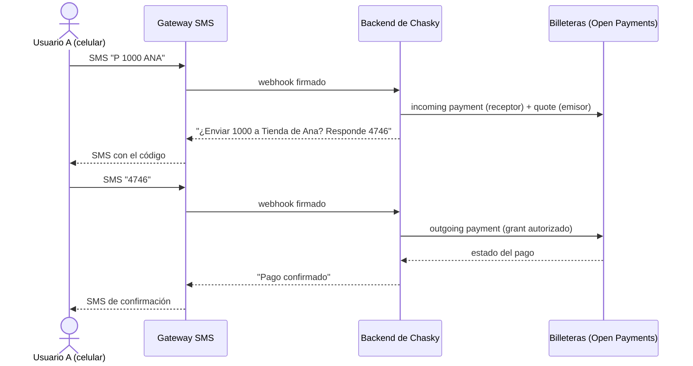

# Chasky

> **El pago llega donde internet no llega.**

[English](README.md) · [Español](README.es.md)

Chasky permite enviar y recibir dinero con un simple mensaje de texto. Sin app, sin datos, sin
smartphone. Es un **gateway SMS para [Open Payments](https://openpayments.dev/)**: el celular solo
habla SMS, y un backend con conexión a internet hace todo lo demás sobre la red de Interledger.

Chasky comienza en **Colombia, con pesos colombianos (COP)**.

---

## El problema que resuelve

Los pagos digitales dan por hecho un smartphone y una conexión de datos. Una gran parte de la
población no tiene ninguna de las dos, o solo las tiene a ratos:

- **Comunidades rurales**, donde la cobertura muchas veces alcanza apenas para llamadas y mensajes
  de texto.
- **Personas con celulares básicos**, porque un smartphone está fuera de su alcance económico.
- **Dueños de un smartphone sin datos**: se acabó el plan o ese día no pueden recargar.
- **Emergencias**, cuando las redes de datos están congestionadas o caídas pero los SMS aún llegan.

Las apps y las billeteras móviles excluyen justamente a estas personas. Chasky las encuentra en el
único canal que ya tienen en el bolsillo.

## Ventajas

| | |
|---|---|
| **Funciona en cualquier celular** | Desde un teléfono básico hasta uno de gama alta. No hay nada que instalar. |
| **No necesita datos** | Funciona con cobertura básica de SMS. |
| **Resiliente** | El SMS guarda y reenvía, y suele seguir funcionando cuando los datos no. |
| **Simple** | Unos pocos comandos cortos que se aprenden en un minuto. |
| **Seguro** | Código de confirmación, vencimiento, intentos limitados y límites de gasto mediante grants. |
| **Abierto e interoperable** | Construido sobre Interledger y Open Payments, puede llegar a cualquier billetera compatible. |

### Casos de uso

- Pagar en una tienda rural sin datos móviles.
- Enviar dinero a la familia desde un celular básico.
- Mover fondos en una emergencia, cuando las redes de datos están caídas.
- Hogares que comparten un único celular básico.

## Cómo se siente

```
Tú:      P 1000 ANA
Chasky:  Envias: 1000
         Destino: Tienda de Ana
         Responde 4746 para pagar. 0 cancela. Vence en 5 min.
Tú:      4746
Chasky:  Pago confirmado: 1000 a Tienda de Ana.
```

| SMS | Acción |
|---|---|
| `P 1000 ANA` | Prepara un pago de 1000 COP al destinatario con alias `ANA` |
| `4746` | Confirma el pago pendiente con el código recibido |
| `0` | Cancela el pago pendiente |
| `1` | Muestra el último pago |
| `9` | Muestra la ayuda |

Los destinatarios se indican por **alias**. No se envía nada hasta que llegue el código correcto.
Más detalle en [`backend/docs/sms-commands.md`](backend/docs/sms-commands.md).

## Arquitectura

El celular nunca toca internet y nunca guarda una llave. Un **gateway SMS** transporta los mensajes
de entrada y salida. Un **backend con conexión a internet** interpreta los comandos, aplica las
verificaciones de seguridad y habla con las billeteras mediante **Open Payments**. Un **dashboard**
web muestra cuentas e historial.



### Flujo de un pago



El celular solo habla SMS. Todo lo que necesita internet ocurre en el backend.

### Modelo de seguridad

- **Las llaves viven en el servidor.** El backend firma las peticiones a las billeteras. El celular
  no guarda credenciales.
- **Los grants son permisos limitados.** Sacar dinero de una cuenta exige un grant de
  outgoing-payment que el dueño de la cuenta aprueba, con un límite de gasto. Crear una solicitud de
  pago en el lado receptor solo necesita un grant limitado y sin interacción.
- **Confirmación por código.** Cada pago requiere un código corto, guardado solo como hash con sal,
  con vencimiento de 5 minutos y un número limitado de intentos.
- **Seguro de repetir.** La confirmación es atómica e idempotente: repetir el código nunca debita dos
  veces.
- **Teléfonos verificados.** Las cuentas están ligadas a un número de teléfono verificado.

## Por qué el nombre Chasky

*Chasky* (también escrito *chasqui*) es la palabra quechua para **mensajero**: el correo, "el que
recibe y da". Los chaskis recorrían las rutas de relevos del camino inca, llevando mensajes y bienes
a través de los Andes de mano en mano, a lugares a los que ningún otro canal llegaba.

Elegimos el nombre como homenaje a nuestros ancestros y a nuestras raíces. Chasky hace el mismo
trabajo en la era digital: recibe un mensaje y entrega valor.

## Primeros pasos

**Requisitos:** Node.js 20+ y PostgreSQL.

### Backend

```sh
cd backend
npm install
cp .env.example .env      # configura DATABASE_URL con tu PostgreSQL
npm run db:migrate
npm run dev               # http://localhost:3000
```

### Frontend

```sh
npm ci --prefix frontend
npm run dev:frontend      # http://localhost:3005
```

Opcionalmente copia `frontend/.env.example` a `frontend/.env.local` para definir
`NEXT_PUBLIC_SMS_NUMBER` (el número SMS público) y `BACKEND_URL`.

### Modo local (sin credenciales)

Con `SMS_PROVIDER=mock` y `PAYMENT_PROVIDER=fake` (los valores por defecto de `.env.example`) puedes
ejecutar todo el flujo sin celulares ni billeteras reales. Envía un SMS simulado:

```sh
curl -s -X POST localhost:3000/dev/sms/simulate \
  -H 'content-type: application/json' \
  -d '{"from":"+573001234567","text":"9"}'
curl -s localhost:3000/dev/sms/outbox
```

### Modo real

Conecta un proveedor SMS real y billeteras Open Payments. Consulta:

- [`backend/docs/relayion.md`](backend/docs/relayion.md): configuración del proveedor SMS
- [`backend/docs/test-wallet.md`](backend/docs/test-wallet.md): Interledger Test Wallet
- [`backend/docs/grants.md`](backend/docs/grants.md): grants, rotación de tokens y presupuestos
- [`backend/docs/sms-commands.md`](backend/docs/sms-commands.md): comandos SMS

### Pruebas

```sh
cd backend && npm run verify   # typecheck + pruebas
```

## Estructura del proyecto

```
backend/     Backend Fastify + TypeScript: gateway SMS, pagos, grants, trabajos
frontend/    Dashboard y portada en Next.js
prompts/     Registro de prompts de IA (política de IA del hackatón)
AI_USAGE.md  Divulgación del uso de IA
```

## Estado

Hoy Chasky es una **prueba de concepto funcional** que valida todo el ciclo sobre la red de pruebas
de Interledger: un mensaje de texto de entrada, una transferencia real de Open Payments entre
billeteras y un mensaje de texto de vuelta. Ya cubre comandos SMS, destinatarios por alias,
confirmación por código, gasto limitado por grants y un dashboard web. Lo que sigue es cómo crece
desde aquí.

## Hoja de ruta

| Fase | Enfoque | Qué entrega |
|---|---|---|
| **0. PoC validada** (hoy) | Ciclo completo | Comandos SMS, destinatarios por alias, códigos de confirmación, gasto limitado por grants, transferencias Open Payments en la red de pruebas, dashboard. |
| **1. Fortalecimiento** | Confiabilidad | Seguimiento del pago y notificación por SMS cuando la red confirma, rotación de tokens, observabilidad y auditoría, revisión de reintentos e idempotencia, pruebas de carga. |
| **2. SMS de grado operador** | Escala y cobertura | Acuerdos con proveedores locales de SMS para **SMS de doble vía** (entrada y salida) sobre un número dedicado, con respaldo entre proveedores, acuses de entrega, gestión de caudal y controles antifraude. El contrato de adaptadores de proveedor ya aísla esta capa. |
| **3. Stack propio de Interledger** | Independencia | Operar **[Rafiki](https://rafiki.dev/)**, el software de código abierto de Interledger, para que Chasky emita direcciones de billetera y liquide por sí mismo en lugar de depender de una billetera de pruebas de terceros. Migrar a **Rhyza**, la próxima generación de Rafiki (aún no liberada), cuando esté disponible. |
| **4. Alta y custodia solo por SMS** | Inclusión | Chasky como **custodio** de las cuentas, con creación de cuentas y billeteras 100% por SMS: el número de teléfono como identidad, código de verificación, PIN y límites por niveles. Seguiremos lo que Rhyza ofrezca para esto y lo adoptaremos donde encaje. Esta fase depende del licenciamiento requerido, o de un socio licenciado, además de niveles KYC/AML. |
| **5. Ecosistema** | Alcance | USSD como canal complementario, herramientas para comercios, red de agentes de efectivo (depósito y retiro). |
| **6. Expansión** | Otros países | Chasky arranca en **Colombia con COP**. El concepto aplica a otros países y monedas, una vez evaluado el marco legal y regulatorio de cada país. |

## Uso responsable de la IA

Este proyecto usa asistencia de IA. Consulta [`AI_USAGE.md`](AI_USAGE.md) y [`prompts/`](prompts/).

---

*Payments reach where the internet doesn't.*
