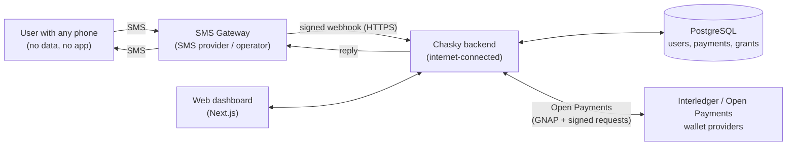
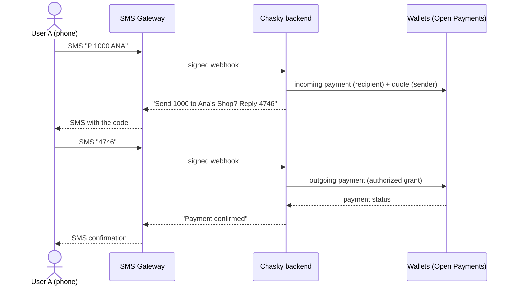

# Chasky

> **Payments reach where the internet doesn't.**

[English](README.md) · [Español](README.es.md)

Chasky lets anyone send and receive money with a plain text message. No app, no data plan, no
smartphone. It is an **SMS gateway for [Open Payments](https://openpayments.dev/)**: the phone only
speaks SMS, and an internet-connected backend does everything else on the Interledger network.

Chasky starts in **Colombia, in Colombian pesos (COP)**.

---

## The problem it solves

Digital payments assume a smartphone and a data connection. A large part of the population has
neither, or has them only some of the time:

- **Rural communities**, where coverage often allows little more than calls and text messages.
- **People with basic phones**, because a smartphone is out of reach economically.
- **Smartphone owners with no data**: the plan ran out, or topping up is not possible that day.
- **Emergencies**, when data networks are congested or down but SMS still gets through.

Apps and mobile wallets exclude exactly these people. Chasky meets them on the one channel that is
already in their pocket.

## Benefits

| | |
|---|---|
| **Works on any phone** | From a feature phone to a flagship. Nothing to install. |
| **No data needed** | Runs on basic SMS coverage. |
| **Resilient** | SMS is store-and-forward and tends to keep working when data does not. |
| **Simple** | A handful of short commands you can learn in a minute. |
| **Secure** | Confirmation code, expiry, limited attempts and spending limits through grants. |
| **Open and interoperable** | Built on Interledger and Open Payments, so it can reach any compatible wallet. |

### Use cases

- Paying a shop in a rural area with no mobile data.
- Sending money to family from a basic phone.
- Moving funds during an emergency, when data networks are down.
- Households that share a single basic phone.

## How it feels

```
You:     P 1000 ANA
Chasky:  Sending: 1000
         To: Ana's Shop
         Reply 4746 to pay. 0 cancels. Expires in 5 min.
You:     4746
Chasky:  Payment confirmed: 1000 to Ana's Shop.
```

| SMS | Action |
|---|---|
| `P 1000 ANA` | Prepare a payment of 1000 COP to the recipient with alias `ANA` |
| `4746` | Confirm the pending payment with the code you received |
| `0` | Cancel the pending payment |
| `1` | Show the last payment |
| `9` | Show help |

Recipients are addressed by **alias**. Nothing is sent until the right code comes back. More detail
in [`backend/docs/sms-commands.md`](backend/docs/sms-commands.md).

## Architecture

The phone never touches the internet and never holds a key. An **SMS gateway** relays text in and
out. An **internet-connected backend** interprets the commands, applies the security checks and talks
to wallets through **Open Payments**. A web **dashboard** shows accounts and history.



### Payment flow



The phone only ever speaks SMS. Everything that needs internet happens in the backend.

### Security model

- **Keys stay server-side.** The backend signs requests to wallets. The phone holds no credentials.
- **Grants are limited permissions.** Moving money out of an account needs an outgoing-payment grant
  that the account owner approves, with a spending limit. Creating a payment request on the receiving
  side needs only a limited, non-interactive grant.
- **Confirmation by code.** Each payment needs a short code, stored only as a salted hash, with a
  5-minute expiry and a limited number of attempts.
- **Safe to repeat.** Confirmation is atomic and idempotent: repeating the code never debits twice.
- **Verified phones.** Accounts are tied to a verified phone number.

## Why the name Chasky

*Chasky* (also written *chasqui*) is the Quechua word for **messenger**: the courier, "the one who
receives and gives". The chaskis ran the relay routes of the Inca road network, carrying messages and
goods across the Andes from hand to hand, in places no other channel could reach.

We chose the name as a tribute to our ancestors and our roots. Chasky does the same job in the
digital age: it receives a message and delivers value.

## Getting started

**Prerequisites:** Node.js 20+ and PostgreSQL.

### Backend

```sh
cd backend
npm install
cp .env.example .env      # set DATABASE_URL to your PostgreSQL
npm run db:migrate
npm run dev               # http://localhost:3000
```

### Frontend

```sh
npm ci --prefix frontend
npm run dev:frontend      # http://localhost:3005
```

Optionally copy `frontend/.env.example` to `frontend/.env.local` to set `NEXT_PUBLIC_SMS_NUMBER`
(the public SMS number) and `BACKEND_URL`.

### Local mode (no credentials)

With `SMS_PROVIDER=mock` and `PAYMENT_PROVIDER=fake` (the defaults in `.env.example`) you can run the
whole flow without real phones or wallets. Send a simulated SMS:

```sh
curl -s -X POST localhost:3000/dev/sms/simulate \
  -H 'content-type: application/json' \
  -d '{"from":"+573001234567","text":"9"}'
curl -s localhost:3000/dev/sms/outbox
```

### Real mode

Connect a real SMS provider and Open Payments wallets. See:

- [`backend/docs/relayion.md`](backend/docs/relayion.md): SMS provider setup
- [`backend/docs/test-wallet.md`](backend/docs/test-wallet.md): Interledger Test Wallet
- [`backend/docs/grants.md`](backend/docs/grants.md): grants, token rotation and budgets
- [`backend/docs/sms-commands.md`](backend/docs/sms-commands.md): SMS commands

### Tests

```sh
cd backend && npm run verify   # typecheck + tests
```

## Project structure

```
backend/     Fastify + TypeScript backend: SMS gateway, payments, grants, jobs
frontend/    Next.js dashboard and landing page
prompts/     AI prompt log (hackathon AI policy)
AI_USAGE.md  AI usage disclosure
```

## Status

Chasky today is a **working proof of concept** that validates the whole loop on the Interledger test
network: a text message in, a real Open Payments transfer between wallets, and a text message back.
It already covers SMS commands, alias-based recipients, code confirmation, grant-limited spending and
a web dashboard. What follows is how it grows from here.

## Roadmap

| Phase | Focus | What it delivers |
|---|---|---|
| **0. Validated PoC** (today) | End-to-end loop | SMS commands, alias recipients, confirmation codes, grant-limited spending, Open Payments transfers on the test network, dashboard. |
| **1. Hardening** | Reliability | Payment follow-up and SMS notification when the network confirms, token rotation, observability and audit, retry and idempotency review, load tests. |
| **2. Carrier-grade SMS** | Scale and coverage | Agreements with local SMS providers for **two-way SMS** (inbound and outbound) on a dedicated number, with failover across providers, delivery receipts, throughput management and anti-fraud controls. The provider adapter contract already isolates this layer. |
| **3. Own Interledger stack** | Independence | Run **[Rafiki](https://rafiki.dev/)**, Interledger's open-source software, so Chasky issues wallet addresses and settles by itself instead of depending on a third-party test wallet. Move to **Rhyza**, the upcoming next generation of Rafiki (not yet released), once it is available. |
| **4. SMS-only onboarding and custody** | Inclusion | Chasky as **custodian** of accounts, with account and wallet creation done 100% by SMS: phone number as identity, verification code, PIN and tiered limits. We will follow what Rhyza offers for this and adopt it where it fits. This phase depends on the required licensing, or a licensed partner, plus KYC/AML tiers. |
| **5. Ecosystem** | Reach | USSD as a complementary channel, merchant tooling, a cash in/out agent network. |
| **6. Expansion** | Other countries | Chasky launches in **Colombia with COP**. The concept applies to other countries and currencies, once the legal and regulatory framework of each country has been evaluated. |

## Responsible use of AI

This project uses AI assistance. See [`AI_USAGE.md`](AI_USAGE.md) and [`prompts/`](prompts/).

---

*El pago llega donde internet no llega.*
