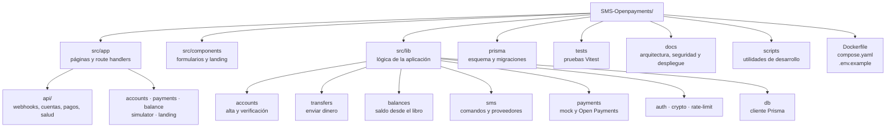
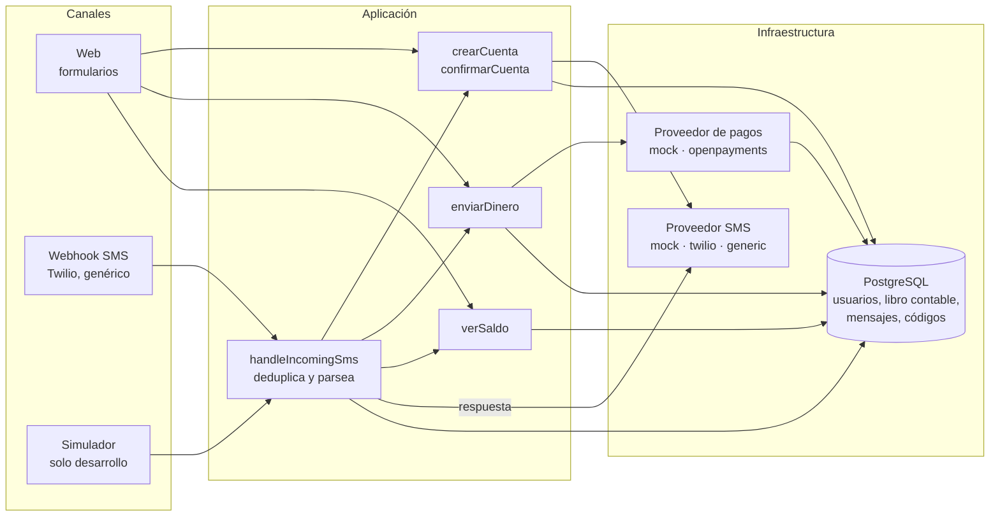
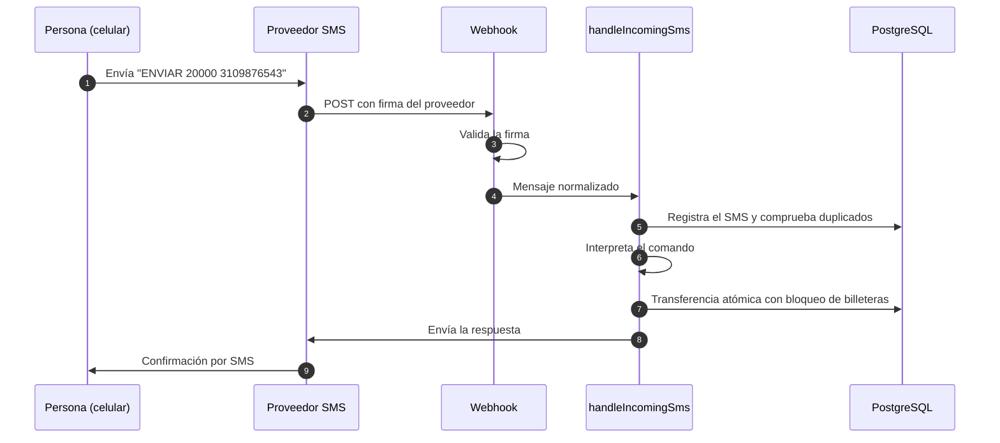

# SMS-Openpayments

Pagos por SMS en Colombia mediante Interledger y Open Payments. Una persona crea su cuenta con el celular,
envía dinero y consulta su saldo escribiendo mensajes de texto, sin apps ni conexión a internet.

## Comandos SMS

| Comando | Ejemplo | Función |
|---|---|---|
| `CREAR <alias>` | `CREAR carlos` | Inicia el alta y envía un código de 6 dígitos |
| `CONFIRMAR <código>` | `CONFIRMAR 123456` | Verifica el número y activa la billetera |
| `ENVIAR <monto> <teléfono>` | `ENVIAR 20000 3109876543` | Transfiere dinero a otro número registrado |
| `SALDO` | `SALDO` | Devuelve el saldo disponible |
| `AYUDA` | `AYUDA` | Lista los comandos |

## Estructura del proyecto



## Flujo de datos

Todos los canales llaman a las mismas funciones de aplicación. La lógica de pagos vive en un único
sitio, así que una transferencia produce el mismo resultado venga por web o por SMS.



### Recorrido de un SMS entrante



## Pagos en modo mock

- Cada usuario tiene una billetera. Los saldos **no se guardan**: se calculan sumando `LedgerEntry`.
- Una transferencia bloquea las dos billeteras con `SELECT … FOR UPDATE`, comprueba el saldo, escribe
  un débito y un crédito del mismo importe y marca la operación como completada.
- La clave de idempotencia es única: un reintento devuelve la operación original.

Más detalle en [`docs/architecture.md`](docs/architecture.md).

## Ejecutar en local

Requisitos: Node.js 22 y Docker (opcional, para PostgreSQL).

```bash
cp .env.example .env          # ajusta los valores
npm ci
npm run db:migrate            # aplica las migraciones
npm run dev                   # http://localhost:3000
```

Pruebas y calidad:

```bash
npm run typecheck
npm run lint
npm run test
npm run build
```

## Despliegue

Con Docker Compose o Coolify: ver [`docs/deployment.md`](docs/deployment.md). El stack tiene tres
servicios: `db` (PostgreSQL), `migrate` (aplica migraciones y termina) y `app` (la aplicación).

## Documentación

- [`docs/architecture.md`](docs/architecture.md): capas, flujo de SMS y modelo de datos.
- [`docs/openpayments.md`](docs/openpayments.md): integración con Open Payments.
- [`docs/sms-providers.md`](docs/sms-providers.md): proveedores SMS y su estado.
- [`docs/security.md`](docs/security.md): controles de seguridad.
- [`docs/deployment.md`](docs/deployment.md): despliegue en producción.
