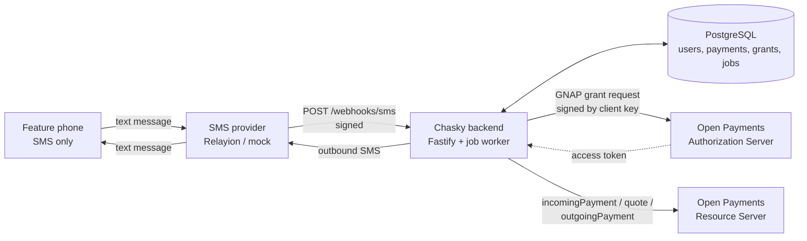
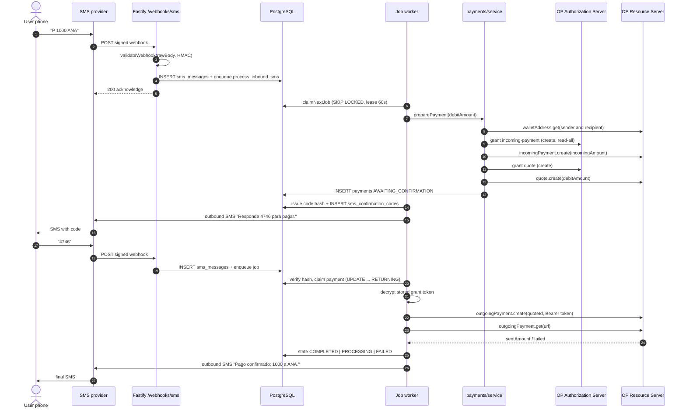
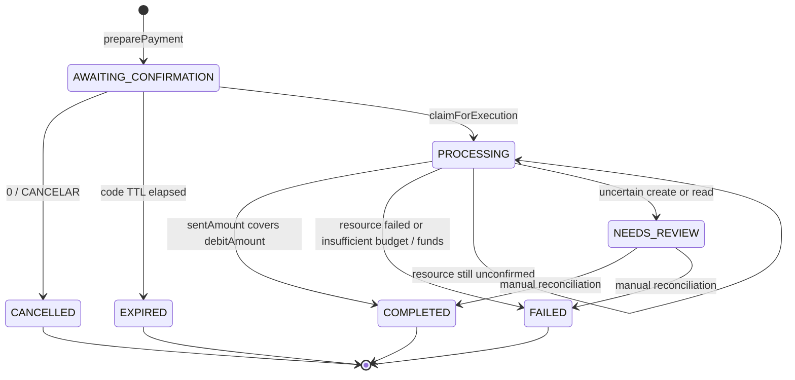

# Backend architecture: inbound SMS to a settled Open Payments payment and back

Last reviewed: 2026-10-17

This document describes the implementation in `backend/src` as checked out on 2026-10-17. It is
descriptive, not aspirational: every mechanism names the file and function that implements it, and
anything not implemented is listed in [Known gaps](#18-known-gaps--next-steps).

## 1. Purpose and scope

Chasky is an **SMS gateway for Open Payments**. A feature phone sends a text message; an
internet-connected Node.js backend authenticates the sender by phone number, prepares a payment
between two wallet addresses, asks for a 4-digit confirmation code over SMS, executes the payment
under a GNAP grant, and replies with the result. The target is **Colombia and Colombian pesos (COP)**
on Interledger Test Wallet accounts with play money ([Test Wallet setup](test-wallet.md),
`README.md`).

In scope: HTTP surface, SMS command engine, payment orchestration, grants and token rotation, the
PostgreSQL job queue, reconciliation, security boundaries, configuration, deployment shape and the
test gate. Out of scope: the Next.js frontend (only its proxy boundary is mentioned), the
Android/carrier side of Relayion, and provider internals.

## 2. System overview

| Participant | Role |
|---|---|
| Feature phone | Sends/receives plain SMS; holds no keys and never reaches the internet. |
| SMS provider | Relayion (`SMS_PROVIDER=relayion`) or an in-memory mock; delivers signed webhooks to `POST /webhooks/sms` and accepts outbound sends. |
| Backend (Fastify) | `backend/src/app.ts` + `backend/src/server.ts`: verifies, persists, enqueues, runs commands/payments and sends replies. |
| PostgreSQL | All state: users, wallets, recipients, grants, payments, SMS log, jobs, audit events (`backend/src/db/migrations/*.sql`). |
| Open Payments AS | Issues grants and access tokens at the wallet's `authServer` (GNAP). |
| Open Payments RS | Hosts incoming-payments, quotes and outgoing-payments at the wallet's `resourceServer`. |
| Test Wallet wallets | Sender, recipient, demo treasury and demo external wallet addresses. |



The backend is both an HTTP server and a worker: `server.ts` listens, then runs `JobProcessor` in a
loop (`JOB_POLL_MS = 500`). With `JOB_WORKER_ENABLED=false` it only serves HTTP
(`backend/src/server.ts:29-35`).

## 3. End-to-end walkthrough

1. **SMS arrives.** The user texts the project number. Relayion receives it on an Android device and
   emits an `inbound.received` webhook ([Relayion adapter](relayion.md)). Command replies reuse the
   number the message arrived on (`inbound.to`); web-login SMS uses `SMS_FROM`.
2. **Webhook.** `POST /webhooks/sms` (`registerSmsRoutes`). `buildApp` installs a JSON content-type
   parser that stores the untouched payload on `request.rawBody` before parsing
   (`backend/src/app.ts:37-49`).
3. **Signature.** `receiveInbound` calls `provider.validateWebhook`. Relayion checks
   `X-Relayion-Signature` as hex HMAC-SHA256 of the raw body with `RELAYION_WEBHOOK_SECRET` and rejects
   events other than `inbound.received`; the mock compares `x-webhook-secret` with
   `SMS_WEBHOOK_SECRET`. Failure → `401 UNAUTHORIZED`.
4. **Normalisation.** `provider.parseIncoming` returns the internal `InboundSms` (`provider`,
   `messageId`, `from`, `to`, `text`, `receivedAt`). Relayion fetches `GET /api/v1/inbound/:id` when
   the webhook omitted `data.body`.
5. **Persist, then acknowledge.** `persistInboundSms` inserts into `sms_messages`
   (`direction='inbound'`, `status='received'`) and enqueues `process_inbound_sms`
   (`{smsId}`, dedupe `sms:<provider>:<messageId>`). `UNIQUE(provider, provider_message_id)` turns a
   repeated delivery into a duplicate: no second row, no job, still `200` with
   `provider.acknowledge()` (`{success:true}` / `{status:"ok"}`).
6. **Queue claim.** The worker claims the job atomically (`claimNextJob`): increments `attempts`,
   sets a 60 s lease.
7. **Command parse.** The `process_inbound_sms` handler (`backend/src/jobs/handlers.ts:59-82`) calls
   `runCommand` in [`command-service.ts`](../src/sms/command-service.ts). Help and unknown commands
   are answered without authentication.
8. **Sender authentication.** `authenticate` normalises the sender to E.164 (`normalizePhone`), looks
   up `users.phone`, and rejects missing, suspended, unverified or non-active accounts.
9. **Payment preparation.** `handlePay` reads the newest wallet, validates amount and alias,
   supersedes any previous pending payment, then calls `preparePayment`
   (`backend/src/payments/service.ts:131`).
10. **Metadata, incoming payment, quote.** `preparePayment` resolves both wallet metadata, validates
    the asset, creates an incoming payment on the **recipient** wallet (bounded by `incomingAmount`
    when assets match or a receive amount was given) and a quote on the **sender** wallet pinned to
    either `debitAmount` or `receiveAmount`, then inserts the `payments` row in
    `AWAITING_CONFIRMATION` with quote amounts, quote id/expiry and incoming-payment id. No
    transaction is held during network calls.
11. **Code + reply.** `issueConfirmationCode` stores only a salted scrypt hash plus a deterministic
    fingerprint and sets `confirmation_expires_at`. The handler replies with `shortPayPrompt` (or
    `confirmationPrompt`) through `sendOutboundSms`, which persists an outbound `sms_messages` row.
12. **User replies the code.** A second webhook/job runs `handleConfirm`: single pending payment,
    lazy expiry, attempt limit, constant-time hash check.
13. **Outgoing access.** `resolveOutgoingAccess` decrypts the newest usable grant token for the
    sender wallet; if none exists it starts an interactive grant and replies with the interaction URL
    instead of charging.
14. **Execution.** `executePayment` claims the payment with a conditional `UPDATE ... RETURNING`
    (`claimForExecution`), checks quote expiry and budget, calls `createOutgoingPayment` with the
    quote id and token, persists the outgoing-payment URL and the resource debit, then calls
    `refreshPaymentStatus` → `getOutgoingPayment`. `COMPLETED` comes only from the resource
    (`sentAmount >= debitAmount`), never from the create call.
15. **Final reply.** `shortOutcomeReply` maps the verified state to SMS. `processed_at` is written
    **before** delivery so an interrupted lease cannot replay the command.
16. **Reconciliation (manual).** `reconcile_payment` inspects an existing outgoing-payment resource
    and persists what it says; it never re-sends.



Exact reply strings from `command-service.ts` (values substituted at runtime):

```text
Envias: <amount>
Destino: <alias>
Recibe: <amount>
Responde <code> para pagar.
0 cancela. Vence en 5 min.

Pago confirmado: <amount> a <alias>.
Pago en proceso: <amount> a <alias>.
Te avisaremos al confirmar.
1 para consultar.
```

The pending-authorization reply is
`"Necesitas autorizar este pago. Abre el enlace y completa la autorización; luego reintenta CONFIRMAR."`
plus a newline and the `interactUrl`.

## 4. Module map

| Directory / file | Responsibility | Key functions |
|---|---|---|
| `backend/src/app.ts` | Fastify assembly, raw body, `/health`, routes, error mapping | `buildApp`, `setErrorHandler` |
| `backend/src/server.ts` | Boot: config, DB, providers, `SecretBox`, worker loop, shutdown | `main`, `loop` |
| `backend/src/config.ts` | Zod environment with cross-field rules | `loadConfig`, `isValidGrantInterval` |
| `backend/src/domain.ts` | Enums, `Amount`, terminal states | `isTerminal` |
| `backend/src/errors.ts` | Stable error codes and HTTP mapping | `AppError`, `httpStatusFor` |
| `backend/src/db/` | Pooled PostgreSQL, `?`→`$n` rewriting, migrations | `createDatabase`, `rewritePlaceholders`, `migrate` |
| `backend/src/sms/` | Webhook ingress, provider adapters, command engine | `receiveInbound`, `persistInboundSms`, `sendOutboundSms`, `runCommand`, `parseCommand` |
| `backend/src/payments/` | Orchestration, OP adapter, fake provider, reconciliation, BigInt math | `preparePayment`, `executePayment`, `refreshPaymentStatus`, `reconcilePayment` |
| `backend/src/jobs/` | Durable queue, processor, handlers, rotation scheduling | `enqueueJob`, `claimNextJob`, `JobProcessor.runOnce`, `registerJobHandlers`, `scheduleGrantTokenRotation` |
| `backend/src/grants/` | Grant admin operations and rotation service | `rotateGrantToken`, `cancelGrant`, `revokeGrantToken` |
| `backend/src/onboarding/` | Users, phone verification, wallet linking, consent callback | `createUser`, `verifyPhone`, `connectWallet`, `completeGrantCallback` |
| `backend/src/recipients/` | Alias recipients and wallet resolution | `createRecipient`, `getRecipientByAlias`, `resolveRecipientWallet` |
| `backend/src/demo/` | Demo wallet pool, assignment, one-time treasury top-up | `importWalletPool`, `registerWithDemoWallet`, `runDemoTopUp` |
| `backend/src/customer/` | Web login, sessions, dashboard, wallet history | `requestLogin`, `verifyLogin`, `sessionUser`, `WalletHistory.read` |
| `backend/src/security/` | Admin bearer auth, AES-256-GCM secret storage | `requireAdmin`, `SecretBox` |
| `backend/src/dev/routes.ts` | Development-only fake-wallet helpers | `registerDevRoutes` |
| `backend/scripts/check-test-wallet.ts` | Read-only Test Wallet preflight | top-level script |
| `backend/tests/` | Vitest suites against embedded PostgreSQL | see §17 |

## 5. Data model

Timestamps are `TEXT` ISO-8601 UTC. Most domain tables carry
`seq BIGINT GENERATED ALWAYS AS IDENTITY` as an insertion-order tiebreaker (exceptions:
`recipient_counters`, `web_*`, `wallet_history_grants`, `schema_migrations`).

| Table | Key columns and constraints |
|---|---|
| `users` | `id` PK, `phone` UNIQUE, `phone_verified_at`, `status` CHECK `pending\|active\|suspended`. |
| `wallets` | `user_id` FK, `wallet_address` UNIQUE, `currency`, `asset_scale`, `auth_server`, `resource_server`. |
| `recipients` | `user_id`, `number` NOT NULL, `alias`, `phone`, resolved `wallet_address`, `currency`, `asset_scale`; `UNIQUE(user_id, alias)` and unique index `(user_id, number)`. |
| `recipient_counters` | `user_id` PK, `next_number >= 1`; monotonic number allocator. |
| `grants` | `wallet_id`, `status` CHECK `PENDING_INTERACTION\|GRANTED\|CANCELLED\|REVOKED\|EXPIRED`, `scopes`, `limit_value/currency/scale`, `access_token_enc`, `access_token_manage_uri`, `continue_uri`, `continue_token_enc`, `interact_url`, `expires_at`, `requires_reconsent`, `last_rotation_error`, `rotation_lock_until`. |
| `payments` | `reference` UNIQUE, `sender_user_id`, `sender_wallet_id`, `recipient_id`, `recipient_wallet_address`, `state` CHECK (8 states), `debit_*`, `receive_*`, `quote_id`, `quote_expires_at`, `incoming_payment_id`, `outgoing_payment_id`, `confirmation_hash`, `confirmation_expires_at`, `confirmation_attempts`, `idempotency_key` UNIQUE, `purpose`, `last_error`. |
| `sms_messages` | `provider`, `provider_message_id`, `direction` CHECK `inbound\|outbound`, `from_phone`, `to_phone`, `text`, `status`, `payment_id`, `error`, `processed_at`, `UNIQUE(provider, provider_message_id)`. |
| `jobs` | `type`, `payload`, `dedupe_key` UNIQUE, `status` CHECK `pending\|leased\|done\|failed`, `attempts`, `max_attempts` default 5, `next_run_at`, `lease_until`, `last_error`. |
| `audit_events` | `type`, `subject_type`, `subject_id`, `data`; written by `recordAudit`, never contains secrets. |
| `phone_verifications` | `user_id`, `phone`, `code_hash`, `attempts`/`max_attempts`, `expires_at`, `consumed_at`. |
| `sms_confirmation_codes` | `user_id`, `payment_id`, `code_hash`, `code_fingerprint`, `UNIQUE(user_id, code_fingerprint)`. |
| `demo_wallet_pool` | `wallet_address` UNIQUE, `role` CHECK `TREASURY\|CUSTOMER\|EXTERNAL_RECIPIENT`, `allocation_status` CHECK `AVAILABLE\|RESERVED\|ASSIGNED`, `assigned_user_id`; CHECKs enforce that status and owner agree and that only CUSTOMER rows may leave AVAILABLE. |
| `demo_assignments` | One per user, pool wallet and wallet (`UNIQUE` each), `onboarding_key` UNIQUE, `funding_status` (6 values), `authorization_status` (4 values), `funding_payment_id`, `funding_error`. |
| `web_login_challenges`, `web_sessions`, `web_test_credentials` | Hashed login codes, session token hashes, optional test passwords. |
| `wallet_history_grants` | Read-only history grant per wallet: `status` (5 values), interaction fields, encrypted tokens, `expires_at`, `next_poll_at`. |
| `schema_migrations` | `version` (filename) + `applied_at`, created by `migrate`. |

### 5.1 Payment state machine



`RECEIVED` is declared in `domain.ts` and allowed by the CHECK, but **no code path writes it**; every
payment starts at `AWAITING_CONFIRMATION`. Terminal states are `COMPLETED`, `CANCELLED`, `EXPIRED`,
`FAILED`; `NEEDS_REVIEW` is deliberately non-terminal and only reconciliation advances it.

## 6. SQL and persistence rules

| Rule | Implementation |
|---|---|
| Parameterised SQL only | Call sites write `?`; `rewritePlaceholders` converts them to `$1, $2, …` and leaves `?` inside single-quoted literals alone (`backend/src/db/connection.ts`). Values are always bound. |
| Transactions | `Db.transaction` wraps BEGIN/COMMIT/ROLLBACK on one pooled client. Network calls happen **before** opening a transaction (`preparePayment`, `connectWallet`, `importWalletPool`). |
| Atomic payment claim | `claimForExecution`: `UPDATE payments SET state='PROCESSING' … WHERE id = ? AND state='AWAITING_CONFIRMATION' RETURNING *`. A second executor gets no row and cannot create a second outgoing payment. |
| Atomic pool reservation | `reserveCustomerWallet` selects with `FOR UPDATE SKIP LOCKED`, so two registrations never receive the same wallet. |
| Atomic job claim | `claimNextJob`: CTE + `FOR UPDATE SKIP LOCKED`, `status IN ('pending','leased')`, `next_run_at <= now`, expired-or-absent lease; sets `leased`, `lease_until`, `attempts+1`. |
| Idempotent SMS ingest | `UNIQUE(provider, provider_message_id)`; `isUniqueViolation` (SQLSTATE 23505) returns the existing row as a duplicate. The job also dedupes on `sms:<provider>:<messageId>`. |
| Idempotent payments | `payments.idempotency_key` UNIQUE; `preparePayment` looks it up first and catches the concurrent-insert violation. Only the demo top-up supplies one (`demo-onboarding:<userId>`); SMS payments do not. |
| Code uniqueness | `UNIQUE(user_id, code_fingerprint)`; a colliding draw is retried. |
| Amounts | `TEXT` scaled integers plus `currency`/`asset_scale`. All arithmetic is `BigInt` (`backend/src/payments/amount.ts`); `sameAsset` requires equal currency and scale and `compareAmounts` throws across assets. `formatForDisplay` is presentation only. |
| Phones | `normalizePhone` strips spaces, `-`, `(`, `)`, `.`; keeps `+`; maps bare `3XXXXXXXXX` to `+57…`; else prefixes `+`; then requires `^\+[1-9]\d{7,14}$`. |
| Timestamps | `nowIso`, `isoPlusMs`, `isoPlusSeconds`, `isPast` (`backend/src/util/time.ts`); comparisons use lexicographic order or `Date.parse`. |
| `int8` | `types.setTypeParser(20, …)` converts counts and identity values to JS numbers; amounts never live in `int8`. |

In `process_inbound_sms`, `processed_at` is committed **before** `sendOutboundSms`
(`backend/src/jobs/handlers.ts:69-81`): a crash can lose the reply but cannot repeat the command.
See §18 for the residual risk.

## 7. SMS command grammar

The user-facing table lives in [`sms-commands.md`](sms-commands.md); this section records parser
rules from `parseCommand` and the engine constants.

| Input | Parsed as | Notes |
|---|---|---|
| `P <amount> <alias>` | `{kind:"pay", short:true}` | Tokens 1 and 2..n; alias may contain spaces. |
| `PAGAR <amount> [CURRENCY] A <alias>` | `{kind:"pay", short:false}` | `A` separator at index ≥ 2; currency is read only when the separator is token 3. |
| `CONFIRMAR <code>` | `{kind:"confirm", short:false}` | Missing code → unknown. |
| `CANCELAR <code>` | `{kind:"cancel", short:false}` | Code verified before cancelling. |
| `ESTADO <reference>` | `{kind:"status", short:false}` | Looks up `payments.reference` for that sender. |
| Bare `0` | `{kind:"cancel", short:true}` | Cancels the single pending payment. |
| Bare `1` | `{kind:"status", short:true}` | Last created payment, any state. |
| Bare `9` | `{kind:"help"}` | Also `AYUDA`, `HELP`, any case. |
| Bare token of ≥ 4 digits | `{kind:"confirm", short:true}` | The confirmation code. |
| `2`, `3`, other 1–3 digit tokens | `{kind:"unknown"}` | `2` is no longer a command; there is no destination list. |

Rules:

- **Authentication first for stateful commands.** `help`/`unknown` bypass it. Everything else
  requires a `users` row matching the normalised sender, status `active`, `phone_verified_at` set.
- **One pending payment per user.** `pendingPayment` selects the newest `AWAITING_CONFIRMATION` row.
  A new `P`/`PAGAR` expires a stale pending payment or cancels it, so the new payment supersedes the
  old one. `MULTIPLE_PENDING_REPLY` exists but is never returned.
- **Amounts.** Short form: positive integers in major units, no dots/commas/signs, scaled by
  `wallet.asset_scale`, ceiling `MVP_MAX_AMOUNT_MAJOR = 1_000_000`. Long form: decimals with at most
  `asset_scale` fraction digits (`parseMajorUnits`). Currency is never echoed: it is the wallet's.
- **Confirmation code.** `CONFIRMATION_TTL_SECONDS = 300`, `CONFIRMATION_MAX_ATTEMPTS = 5`;
  4 digits initially, growing once `usedCount >= 10^length` (`confirmationCodeLength`). Stored as
  `scrypt(code, 16-byte salt, 32)` in `salt.hash` base64; never stored or logged in plaintext. A wrong
  code increments `confirmation_attempts` and replies `Codigo incorrecto. Quedan N intentos.`
- **Expiry is lazy.** `expireIfStale` moves `AWAITING_CONFIRMATION → EXPIRED` and clears the hash on
  the next pay/confirm/cancel/status; there is no timer.
- **Cancel is atomic.** `cancelPendingPayment` only updates `WHERE state='AWAITING_CONFIRMATION'`;
  `0` needs no code, `CANCELAR` requires it.
- **No code echo.** `shortStateAction` tells a pending user to reuse the original SMS.

Exact help (`SHORT_HELP_TEXT`, returned by `9`, `AYUDA`, `HELP`):

```text
Para pagar: P <monto> <destino>
Ejemplo:    P 1000 RUTA
Confirmar:  responde solo el codigo de 4 digitos
0 cancela | 1 ultimo pago | 9 ayuda
```

Unknown text → `Comando no reconocido. 9 para ayuda.`

## 8. Recipients and aliases

- **Creation.** `createRecipient` requires exactly one of `walletAddress`/`phone` (route refine).
  `resolveRecipientWallet` discovers metadata or resolves a phone only when it belongs to a
  registered user with a wallet. The resolved address, currency and scale are stored on the row, so a
  later alias change cannot redirect the destination.
- **Permanent numbers.** `allocateRecipientNumber` runs in the same transaction as the insert
  (`INSERT … ON CONFLICT DO UPDATE … RETURNING next_number - 1`). A failed insert rolls the counter
  back; a deleted recipient's number is never reissued. The SMS interface no longer accepts numbers.
- **Resolution used by SMS.** `resolveRecipientByAlias` tries `getRecipientByAlias`
  (`lower(alias) = lower(?)`, per user), then scans `listRecipients` with `foldAlias` (lowercase, all
  whitespace removed). `TIENDARUTAN`, `Tienda Ruta N` and `tienda ruta n` match the same row of
  **that sender**.
- **Global fallback.** `resolveRecipientByAlias` (SMS) prefers the sender's own rows and then calls
  `getGlobalRecipientByAlias`, which scans every recipient ordered by `created_at`. Destinations are
  therefore global: any sender can pay any registered alias, and the sender's own copy of a name wins
  when it exists. `getRecipientByDestination` implements the same rule for callers that accept a
  permanent number. The test `los destinos son globales: un alias registrado por otro usuario sí se
  puede pagar` covers both the shared alias and an alias nobody registered.
- **Cross-user demo payments** work by pre-registering the external wallet as a recipient of each
  customer under `DEMO_EXTERNAL_ALIAS` (`ensureDemoExternalRecipient`, see
  [`demo-wallet-pool.md`](demo-wallet-pool.md)).
- **Constraints.** `UNIQUE(user_id, alias)` is case-sensitive and case folding is application-level,
  so two users may hold the same alias and one user may hold `ANA` and `ana`. There is no global
  uniqueness.

## 9. Open Payments integration

All SDK usage lives in `OpenPaymentsProvider` in
[`open-payments.ts`](../src/payments/open-payments.ts), built by `createPaymentProvider` when
`PAYMENT_PROVIDER=openpayments`, from `OP_CLIENT_WALLET_ADDRESS`, `OP_KEY_ID` and a key read from
`OP_PRIVATE_KEY_PATH` or inline `OP_PRIVATE_KEY_PEM` (PEM wins, `\n` expanded). The authenticated
client is lazy and cached, with a 10 s request timeout.

| Order | SDK call | Purpose | Grant / credential |
|---|---|---|---|
| 1 | `walletAddress.get({url})` | Discover `assetCode`, `assetScale`, `authServer`, `resourceServer` | None |
| 2 | `grant.request({url: authServer}, …)` | Non-interactive incoming-payment access on the recipient wallet | type `incoming-payment`, actions `create`, `read-all`, identifier = recipient address |
| 3 | `incomingPayment.create({url: resourceServer, accessToken}, {walletAddress, incomingAmount?})` | Resource the sender pays into | Token from step 2 |
| 4 | `grant.request({url: authServer}, …)` | Non-interactive quote access on the sender wallet | type `quote`, actions `create` |
| 5 | `quote.create({url: resourceServer, accessToken}, {walletAddress, receiver, method:"ilp", debitAmount\|receiveAmount})` | Fix exchange and amounts | Token from step 4 |
| 6 | `grant.request({url: authServer}, …)` | Interactive outgoing-payment consent | type `outgoing-payment`, actions `create`+`read`, identifier = sender address, `limits.debitAmount`, optional `limits.interval` |
| 7 | `grant.continue({url: continueUri, accessToken: continueToken}, {interact_ref})` | Finish consent after the redirect | Continue token |
| 8 | `outgoingPayment.create({url: resourceServer, accessToken}, {walletAddress, quoteId, metadata:{reference}})` | Execute the transfer | Outgoing grant token |
| 9 | `outgoingPayment.get({url: outgoingPaymentId, accessToken})` | Authoritative status read | Outgoing grant token |
| 10 | `token.rotate`, `token.revoke`, `grant.cancel` | Token/grant management | `access_token.manage` / `continue` URIs |

`toOpAmount`/`fromOpAmount` convert `value`/`assetCode`/`assetScale`. The quote takes exactly one
amount: `debitAmount` when the sender typed a debit, `receiveAmount` when the caller pinned the receive
side (demo top-up). `preparePayment` also passes `incomingAmount` to bound the recipient's incoming
payment.

**Status derivation.** The SDK response has no `status`, so `mapOutgoingPayment` derives it: `failed`
→ `FAILED`; same asset with `sentAmount >= debitAmount` → `COMPLETED`; otherwise `PROCESSING`.

**Grant storage.** `grants.access_token_enc` and `continue_token_enc` hold `iv.tag.ciphertext`
AES-256-GCM payloads from `SecretBox`. `access_token_manage_uri` is plaintext (a URI, not a bearer
credential) and is never returned or logged. `wallet_history_grants` encrypts its tokens the same way.

**Error classification** (`mapClientError`):

| Provider signal | Code | Consequence in `executePayment` |
|---|---|---|
| budget/limit/grant + insufficient/exceed, or HTTP 403 | `INSUFFICIENT_GRANT_BUDGET` | `markFailed` → `FAILED` |
| funds/balance | `INSUFFICIENT_FUNDS` | `markFailed` → `FAILED` |
| HTTP 401 | `UNAUTHORIZED` | uncertain create → `NEEDS_REVIEW`; rotation → `requires_reconsent` |
| anything else | `PROVIDER_ERROR` | uncertain create/read → `NEEDS_REVIEW` (never blind retry) |

**Budget pre-check.** `executePayment` asks `provider.getGrantUsage` before creating the payment. The
real provider returns `null` ("not supported: the management URL is not exposed"), so the check is
skipped and the resource server stays authoritative. The fake provider implements it, which is how
budget tests are driven.

## 10. Grant lifecycle and token rotation

Grants are requested in `connectWallet` (onboarding), `resolveOutgoingAccess` (SMS confirmation) and
`ensureTreasuryAccessToken` (demo top-up); each computes
`finishUri = ${PUBLIC_BASE_URL}/auth/callback?grant_id=<uuid>` and a random nonce.

- **Interactive consent is a stored interaction, not admin trust.** `completeGrantCallback` loads the
  grant by id, requires `PENDING_INTERACTION` and `continue_token_enc`, decrypts it, calls
  `continueGrant`, and only then writes `GRANTED` with the encrypted token, `manage` URI and expiry
  (`onboarding/service.ts:404-444`). The callback route is public on purpose.
- **`OP_GRANT_INTERVAL`.** A GNAP/ISO-8601 repeating interval such as
  `R1/2026-10-16T00:00:00Z/P1Y`, sent as `limits.interval` on every outgoing-payment grant
  (`requestOutgoingAccess` falls back to config; onboarding and the demo treasury pass it explicitly).
  Empty omits it. `isValidGrantInterval` only rejects malformed values; the AS decides the window.
- **Two clocks.** The AS owns the access-token TTL (`expires_in`, ~10 min on the Test Wallet); grant
  limits persist. [`grants.md`](grants.md) documents this and the fact that the client cannot ask for
  a longer token lifetime.
- **Scheduling.** `scheduleGrantTokenRotation` runs at `max(now, expiresAt - 120_000)` with payload
  `{grantId, expectedExpiresAt}` and dedupe `rotate_grant_token:<grantId>:<expiresAt>`. Grants with no
  known expiry are not scheduled.
- **Execution.** The handler skips the job unless the grant is `GRANTED`, not `requires_reconsent`,
  and `expires_at` still equals `expectedExpiresAt`. `rotateGrantToken` takes a 60 s single-flight
  lock, refuses an already-expired token, stores the replacement and schedules the next rotation.
  Expired/rejected/unauthorized → `requires_reconsent = 1` plus audit; transient → lock released and
  the job retried with backoff.

## 11. Jobs and background processing

`backend/src/jobs/repository.ts` is a PostgreSQL queue; `JobProcessor`
([`processor.ts`](../src/jobs/processor.ts)) owns the loop.

| Job type | Payload | Enqueued by | Handler | Recovery inspector |
|---|---|---|---|---|
| `process_inbound_sms` | `{smsId}` | `persistInboundSms`, dedupe `sms:<provider>:<messageId>` | `runCommand` then `sendOutboundSms` | complete if `processed_at`, else requeue |
| `reconcile_payment` | `{paymentId, accessToken?}` | **nothing in `src`** (see §18) | `reconcilePayment` | complete if terminal, else requeue |
| `demo_topup` | `{assignmentId}` | `registerWithDemoWallet` (inside the registration transaction); `enqueueReconciliation` 5 s later | `runDemoTopUp` | complete if funding settled, else requeue |
| `rotate_grant_token` | `{grantId, expectedExpiresAt}` | `scheduleGrantTokenRotation` | `rotateGrantToken` | complete if not GRANTED / needs reconsent / expired, else requeue |

- **Lease:** 60 s; `runOnce` claims at most one job. The loop sleeps 500 ms when idle, 1 s after a
  processor error.
- **Attempts:** `max_attempts` defaults to 5; `attempts` increments at claim time.
  `recovered = job.attempts > 1` is passed to handlers.
- **Backoff:** `failJob` schedules `retryDelayMs * 2^(attempts-1)` (base 5 000 ms): 5 s, 10 s, 20 s,
  40 s, then `failed` on the fifth failure, writing `last_error`.
- **Recovery:** just before the worker loop starts, `recoverExpiredLeases` inspects expired `leased`
  jobs that have an inspector; `complete` marks done, anything else goes through `failJob`. Jobs
  without an inspector are left for `runOnce` with `recovered = true`.
- **Worker switch:** `JOB_WORKER_ENABLED=false` serves HTTP only. Webhooks still persist and
  acknowledge; nothing is consumed until a worker runs.

## 12. Reconciliation

`reconcilePayment` in [`reconciliation.ts`](../src/payments/reconciliation.ts) is a read-only pass:
terminal → `terminal`; no `outgoing_payment_id` → `unresolved` (it will not create one); no access
token → `unresolved`; otherwise `refreshPaymentStatus` → `getOutgoingPayment` →
`applyProviderStatus`, yielding `completed`, `failed` or `still_processing`. Any provider exception →
`unresolved` with the state unchanged.

It deliberately **does not re-send** and does not enqueue a new payment. `reconcilePendingPayments`
scans up to 50 `PROCESSING`/`NEEDS_REVIEW` rows by `updated_at`, but only tests call it. No route,
cron or handler enqueues `reconcile_payment`; the only in-repo re-enqueue loop is `demo_topup`
(`enqueueReconciliation`). An SMS payment that ends in `PROCESSING` therefore stays there until an
operator or a future scheduler runs reconciliation (§18).

## 13. HTTP surface

`buildApp` always registers customer and SMS routes; onboarding, recipient, grant and demo routes are
registered only when a payment provider exists (always true in `server.ts`); dev routes are skipped in
production.

| Method | Path | Auth | Purpose |
|---|---|---|---|
| GET | `/health` | None | Liveness + providers/currency (see §16). |
| POST | `/webhooks/sms` | Provider signature: `X-Relayion-Signature` or `x-webhook-secret` (mock) | Ingest, verify, persist and enqueue; `200` success/duplicate, `401` bad signature, `400` bad payload. |
| POST | `/dev/sms/simulate` | None, non-production | Persist a simulated SMS and answer stateless commands synchronously. |
| GET | `/dev/sms/outbox` | None, non-production | Mock outbox. |
| GET | `/dev/sms/messages` | None, non-production | Last 50 `sms_messages`. |
| POST | `/dev/payments/register-wallet` | None, non-production, fake provider | Register a fake wallet. |
| GET | `/dev/payments/payments` | None, non-production, fake provider | Provider name probe. |
| POST | `/admin/users` | Admin bearer | Create a user; `assignDemoWallet: true` reserves a wallet and enqueues the top-up (`201` first assignment, `200` existing). |
| POST | `/admin/users/:id/phone/request-code` | Admin bearer | Issue a 6-digit code; returns `devCode` outside production. |
| POST | `/admin/users/:id/phone/verify` | Admin bearer | Consume the code and activate the user. |
| POST | `/admin/users/:id/wallets/connect` | Admin bearer | Link a wallet and start the outgoing grant. |
| POST | `/admin/users/:id/recipients` | Admin bearer | Create an alias recipient from exactly one of `walletAddress`/`phone`. |
| GET | `/admin/users/:id/recipients` | Admin bearer | List recipients by permanent number. |
| GET | `/admin/users/:id/recipients/:alias/resolve` | Admin bearer | Resolve a stored alias. |
| GET | `/admin/grants/:id/usage` | Admin bearer | Budget usage (`supported:false` when unavailable). |
| POST | `/admin/grants/:id/cancel` | Admin bearer | Cancel grant and clear tokens. |
| POST | `/admin/grants/:id/token/rotate` | Admin bearer | Force rotation. |
| POST | `/admin/grants/:id/token/revoke` | Admin bearer | Revoke and mark `REVOKED`. |
| POST | `/admin/demo/wallet-pool/import` | Admin bearer | Import treasury + customers (+ optional external). |
| GET | `/admin/users/:id/demo-status` | Admin bearer | Assignment/funding progress, never tokens. |
| GET | `/auth/callback` | None; validates stored interaction | Complete a grant: `grant_id` + `interact_ref`. |
| GET | `/customer/login/options` | None | Test-password availability. |
| POST | `/customer/login/request` | None, rate-limited | Send a 6-digit web login code. |
| POST | `/customer/login/verify` | None | Exchange code for an 8-hour session token. |
| POST | `/customer/login/password` | None, dev + flag only | Test-password login. |
| POST | `/customer/logout` | Session bearer | Delete the session. |
| POST | `/customer/history/connect` | Session bearer | Start/refresh the history grant. |
| GET | `/customer/dashboard` | Session bearer | User, wallets, grants, movements, demo status, budget hint. |

`app.ts` maps `ZodError` → `400 VALIDATION_FAILED` with `issues`; `AppError` → `httpStatusFor(code)`
and `{error, message}`; anything else → `500 INTERNAL`.

## 14. Security

- **Secrets at rest.** `SecretBox` ([`encryption.ts`](../src/security/encryption.ts)) uses AES-256-GCM
  with a random 12-byte IV and payload `iv.tag.ciphertext` (base64). `ENCRYPTION_KEY` must decode to
  exactly 32 bytes (64 hex or base64). Used for grant access/continue tokens and history tokens; the
  key lives only in the environment.
- **Webhook authenticity.** Relayion: HMAC-SHA256 over `request.rawBody`, `timingSafeEqual`, and only
  `inbound.received`. The mock's shared header secret is a development transport, not a boundary.
- **Admin boundary.** `/admin/*` requires `Authorization: Bearer <ADMIN_API_TOKEN>`; `requireAdmin`
  hashes both sides with SHA-256 before `timingSafeEqual`, so timing does not leak the token.
- **Customer boundary.** `/customer/*` uses an opaque 32-byte token stored only as a SHA-256 hash
  (`web_sessions.token_hash`), 8-hour expiry. Login codes are 6 digits, 5 minutes, scrypt-hashed,
  5 attempts, rate-limited per phone/IP with `pg_advisory_xact_lock`. The Next.js bridge keeps the
  token in an HttpOnly, SameSite=Lax cookie and never forwards admin credentials to the browser.
- **Confirmation codes.** Salted scrypt hash + fingerprint, constant-time verification, 5 attempts,
  5-minute TTL; the plaintext is unrecoverable, so a later reply cannot repeat it.
- **No secret reaches browser code.** Dashboard and demo-status queries project explicit columns;
  `access_token_manage_uri`, encrypted tokens and continue tokens are never serialised.
- **Audit trail.** `recordAudit` records user creation, phone verification, grant lifecycle events,
  recipient creation and demo assignment; identifiers and flags only, never secrets.

## 15. Configuration

Parsed once by `loadConfig` with Zod (`backend/src/config.ts`); defaults are schema defaults.

| Variable | Default | Purpose / rule |
|---|---|---|
| `NODE_ENV` | `development` | `development\|test\|production`; production disables dev routes and `devCode`, `test` disables the logger. |
| `PORT` | `3000` | Positive integer. |
| `PUBLIC_BASE_URL` | `http://localhost:3000` | Base for the grant `finishUri`; must be reachable for real consent. |
| `DATABASE_URL` | — (required) | PostgreSQL connection string. |
| `ADMIN_API_TOKEN` | `dev-admin-token` | Bearer token for `/admin/*`. |
| `ENCRYPTION_KEY` | `""` | 32-byte AES key; empty disables `SecretBox` and the server refuses to start with `openpayments`. |
| `JOB_WORKER_ENABLED` | `true` | `false` serves HTTP only. |
| `TEST_PASSWORD_LOGIN_ENABLED` | `false` | Dev-only test-password login. |
| `PAYMENT_PROVIDER` | `fake` | `fake` or `openpayments`. |
| `PAYMENT_CURRENCY` | `COP` | Three uppercase letters; must match the wallets. |
| `PAYMENT_ASSET_SCALE` | `0` | 0–12. |
| `DEMO_WALLET_ASSIGNMENT_ENABLED` | `false` | Enable the demo pool. |
| `DEMO_TOPUP_AMOUNT` | `1000` | Minor units the customer must receive; digits only. |
| `DEMO_TOPUP_CURRENCY` | `COP` | ISO-4217. |
| `DEMO_TOPUP_ASSET_SCALE` | `0` | 0–12. |
| `DEMO_TOPUP_MAX_AMOUNT` | `10000` | Ceiling for the treasury debit; ≥ the top-up. |
| `DEMO_EXTERNAL_ALIAS` | `EXTERNAL` | Alias for the pool's external recipient. |
| `OP_CLIENT_WALLET_ADDRESS` | `""` | Client wallet; required with `openpayments`. |
| `OP_KEY_ID` | `""` | Signing key id; required with `openpayments`. |
| `OP_PRIVATE_KEY_PATH` | `""` | PEM path; one of path/PEM required with `openpayments`. |
| `OP_PRIVATE_KEY_PEM` | `""` | Inline PEM (wins over path; `\n` unescaped). |
| `OP_GRANT_INTERVAL` | `""` | Optional GNAP interval matching `^R\d*\/[^/]+\/[^/]+$`. |
| `OP_HISTORY_WALLET_ADDRESS` | `""` | Wallet allowed for read-only history. |
| `OP_HISTORY_KEY_ID` | `""` | History client key id. |
| `OP_HISTORY_PRIVATE_KEY_PATH` | `""` | History client key file. |
| `SMS_PROVIDER` | `mock` | `mock` or `relayion`. |
| `SMS_FROM` | `+570000000000` | Sender number for web-login SMS and the dev simulator's default `to` (placeholder here). |
| `SMS_WEBHOOK_SECRET` | `dev-webhook-secret` | Mock webhook header secret. |
| `RELAYION_API_KEY` | `""` | Required with `relayion`; `Authorization: Bearer …`. |
| `RELAYION_WEBHOOK_SECRET` | `""` | Required with `relayion`; HMAC key. |
| `RELAYION_DEVICE_ID` | `""` | Optional outbound device override. |

Cross-field rules: `OP_GRANT_INTERVAL` format; with `openpayments` the client address + key id + one
key source; with `relayion` the API key + webhook secret; with demo assignment a top-up > 0 and
≤ `DEMO_TOPUP_MAX_AMOUNT`. Messages are Spanish; field names are stable.

## 16. Deployment (Railway)

The repository defines the backend image and the frontend run commands, but **no
`railway.json`/`railway.toml`**: the three-service topology is dashboard configuration. Expected
shape:

| Service | Build | Start | Notes |
|---|---|---|---|
| Backend | `backend/Dockerfile` (`node:22-slim`, `npm ci --omit=dev`, copies source) | `npm start` → `tsx src/server.ts` | `tsx` is a runtime dependency; listens on `0.0.0.0:$PORT`. |
| Frontend | Root `frontend/`, `npm ci && npm run build` | `npx next start --hostname 0.0.0.0 --port $PORT` | Proxies `/api/customer/*` to `BACKEND_URL`, sets the HttpOnly cookie (`frontend/README.md`). |
| PostgreSQL | Railway PostgreSQL | managed | `DATABASE_URL` shared with local tooling. |

`GET /health` runs `SELECT 1` and returns (example values):

```json
{
  "status": "ok",
  "smsProvider": "relayion",
  "paymentProvider": "openpayments",
  "currency": "COP",
  "testFunds": false,
  "time": "<ISO-8601>"
}
```

`testFunds` is `true` when `PAYMENT_PROVIDER=fake` or `DEMO_WALLET_ASSIGNMENT_ENABLED=true`, so the
field warns that the deployment moves play money.

**Migrations.** `createDatabase` runs `migrate` by default and `server.ts` passes no options, so
pending migrations apply at boot, one transaction per file, recorded in `schema_migrations`.
`npm run db:migrate` applies them manually. Files are ordered by lexicographic filename; the directory
has gaps and duplicate numeric prefixes (`005_customer_login.sql` before
`005_grant_token_manage.sql`, `006_demo_external_recipient.sql` before
`006_test_password_login.sql`), so new names must sort in dependency order. There is no separate
release phase.

The worker runs in the same process as the web server. Multiple instances are safe for job claiming
(`FOR UPDATE SKIP LOCKED`) and pool reservation, but each polls the same queue.

## 17. Testing and verification

- **Runner.** `backend/vitest.config.ts`: Node, `tests/**/*.test.ts`, `pool: "forks"`,
  `fileParallelism: false` (one real PostgreSQL shared by all files), 30 s test/hook timeouts.
- **Database.** `tests/global-setup.ts` starts a disposable `embedded-postgres` unless
  `TEST_DATABASE_URL` is set. `tests/helpers.ts` truncates every domain table
  (`RESTART IDENTITY CASCADE`) before each test and builds `testConfig()` with `NODE_ENV=test`.
- **Suites (13 files):** `accounts`, `commands`, `mvp-commands`, `payments`, `jobs`, `sms`,
  `relayion`, `grant-rotation`, `demo-wallet-pool`, `customer`, `wallet-history`,
  `test-wallet-check`, `config`. `relayion` alone has three `describe` blocks (provider, webhook
  route, configuration).
- **Gate.** `backend/package.json`: `verify = typecheck && test`; root `package.json`:
  `verify = backend verify && frontend typecheck`. `scripts/verify.sh` delegates to
  `scripts/harness/verify.mjs`, which runs the command in `.agent-workflow/project.json`
  (`npm run verify`). This is the canonical mechanical gate.
- **Focused runs** (`cd backend && npx vitest run tests/mvp-commands.test.ts`) skip the typecheck and
  the other suites, so they are not the gate. The read-only Test Wallet preflight
  (`npm run check:testwallet -- <sender> <receiver>`) is not part of `verify` and moves no money.

## 18. Known gaps / next steps

Observable in the current code; none is a design proposal.

1. **No automatic reconciliation for SMS payments.** `reconcile_payment` is registered but never
   enqueued; `reconcilePendingPayments` is only called from tests. A `PROCESSING` payment replies
   "Te avisaremos al confirmar" but nothing sends that follow-up. The only re-enqueue loop is
   `demo_topup`.
2. **Errors thrown by `executePayment` produce no SMS reply.** `handleConfirm` has no `try/catch`
   around it, so `QUOTE_EXPIRED`, `INSUFFICIENT_GRANT_BUDGET`, `INSUFFICIENT_FUNDS` and `CONFLICT`
   escape `runCommand`; the job retries and fails while the user hears nothing. The `FAILED` SMS
   branch only runs when `executePayment` returns a snapshot.
3. **Quote lifetime is shorter than the advertised 5 minutes.** The prompt says "Vence en 5 min", but
   quote expiry comes from the provider (fake default: 60 s). Confirming later hits gap 2.
4. **Authorization links are delivered by SMS.** When no grant is usable the reply appends the raw
   `interactUrl`; consent needs a browser and data, and the user must resend the code afterwards.
5. **Sender-wallet selection is "most recently created".** `latestWallet` orders by
   `created_at DESC, seq DESC LIMIT 1`; there is no explicit default, so linking a second wallet
   silently changes the sender wallet.
6. **No authenticated balance API.** The dashboard derives a `budget` from `getGrantUsage`, but the
   real provider returns `null`; the response then says the balance must be checked in Test Wallet.
   Grant budget ≠ balance.
7. **No SMS self-registration.** Unknown senders get `No encontramos una cuenta asociada a este
   número. Regístrate o contacta a soporte.`, but registration exists only through `/admin/users`.
   There is no SMS sign-up, PIN, KYC or tiering.
8. **Admin grant cancel/revoke cannot work with the real provider.** `grants/service.ts` calls
   `cancelGrant({wallet, accessToken})` and `revokeAccessToken({wallet, accessToken})`, while
   `OpenPaymentsProvider` requires `continueUri`/`manageUri` and throws `PROVIDER_ERROR`; the interface
   does not accept those URIs for these methods. The routes fail with `502` on `openpayments` and work
   on `fake`.
9. **The dev simulator can answer twice.** `/dev/sms/simulate` persists + enqueues (like the webhook)
   **and** synchronously calls `handleInboundCommand` + sends. With the worker enabled the job replies
   again. The synchronous entry only handles help/unknown; payment commands return
   `"Este comando se procesa en segundo plano. Recibirás la respuesta por SMS en unos segundos."`
10. **Interrupted execution can replay a state-changing command.** `processed_at` is written after
    `runCommand`; if the lease expires during it, the inspector requeues and `P` runs again. SMS
    payments have no idempotency key: `handlePay` cancels the previous pending payment and creates a
    new one. The guarantee is "at most one executable code at a time", not "exactly one payment row".
11. **A reply can be lost after a crash.** `processed_at` commits before `sendOutboundSms`, so a
    delivery failure leaves the command marked processed with no retry.
12. **`RECEIVED` is unused**, and several codes/constants are never produced
    (`CONFIRMATION_INVALID`, `CONFIRMATION_EXPIRED`, `PAYMENT_NOT_CANCELLABLE`, `DUPLICATE_MESSAGE`,
    `MULTIPLE_PENDING_REPLY`).
13. **Budget pre-check is a no-op against the real provider.** `getGrantUsage` returns `null` by
    design; only the resource server enforces the limit.
14. **`/auth/callback` returns JSON** (`{ok, grantId, status}`); there is no redirect back to a UI.
15. **No versioned deployment descriptor.** There is no `railway.json`; the topology is dashboard
    configuration and the frontend start command is documented only in `frontend/README.md`.

## 19. Glossary

| Term | Meaning here |
|---|---|
| **Wallet address** | Open Payments identifier of an account (`https://…/<wallet>`), resolved to `authServer` and `resourceServer`. |
| **Authorization Server (AS)** | Issues grants and access tokens at `wallet.authServer`. |
| **Resource Server (RS)** | Hosts payment resources; calls target `wallet.resourceServer`. |
| **Incoming payment** | Resource on the recipient wallet defining what can be paid in (optionally bounded by `incomingAmount`). |
| **Quote** | Fixed amount pair (`debitAmount`, `receiveAmount`, `expiresAt`) linking an incoming payment to an outgoing payment. |
| **Outgoing payment** | The transfer from the sender wallet, created from a quote under an outgoing-payment grant; `sentAmount` confirms settlement. |
| **Grant** | GNAP authorization: `access` entries (type, actions, identifier, `limits`). Interactive grants need consent. |
| **Access token** | Bearer credential for resource calls; short-lived and rotatable via `access_token.manage`. |
| **Continue token / URI** | Credentials used to finish an interactive grant at `/auth/callback`. |
| **ILP** | Interledger Protocol, the packet protocol wallets settle over; the quote uses `method: "ilp"`. |
| **ASE** | Account Servicing Entity: the Interledger role that services accounts, tracks balances and settles ILP packets behind the resource server. |
| **Asset scale** | Decimal places defining the minor unit; `COP@0` stores whole pesos. |
| **E.164** | Phone format required by `normalizePhone` (`+` and 8–15 digits). |
| **Grant budget vs balance** | A grant caps what the client may spend; it adds no funds. Balance is not exposed by the Open Payments SDK. |
