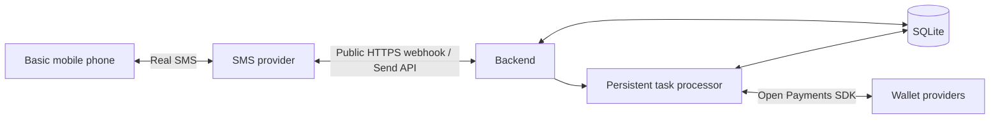

# Prompts — Specs del backend (iteración 1) (2026-10-16)

## Prompt (texto real, íntegro)

````text
. Objective and scope
Build a backend that allows people with basic mobile phones to initiate and confirm payments by SMS, using Open Payments.
Users connect their wallets and grant payment permissions through an assisted onboarding process. Subsequent payments use SMS while the authorization remains valid and sufficient.
The system must support:
- Real inbound and outbound SMS.
- Assisted phone verification and wallet connection.
- Payment initiation, confirmation, cancellation, and status queries.
- Recipient registration during use.
- Currency codes, asset scales, and sender/recipient amounts.
- Grant management, payment tracking, and reconciliation.
- Persistent recovery after restarts.
Interledger Test Wallet is the initial integration environment. The architecture is not restricted to test funds or a single currency. Connecting a production provider requires validating its capabilities and operational requirements.
2. Technology stack
Component	Technology	Responsibility
Runtime	Node.js + TypeScript	Run the backend.
HTTP server	Fastify	SMS webhooks, onboarding, and protected operations.
Database	SQLite + better-sqlite3	Persistent storage using direct SQL, without an ORM.
Validation	Zod	Validate configuration, requests, and commands.
Payment SDK	@interledger/open-payments	Make signed Open Payments requests.
Messaging	Bidirectional SMS provider	Receive real messages and send responses.
Tests	Vitest	Verify payment controls and recovery behavior.


The initial deployment uses one application process and a persistent SQLite file. A database-backed work queue handles pending tasks without requiring Redis or an external queue.
3. Interledger technologies and integration
Capability	How the backend uses it
Wallet Addresses	Discover account metadata, currency, asset scale, authorization server, and resource server.
Open Payments SDK	Initialize an authenticated client and make signed API requests.
GNAP grants	Request scoped access to payment resources with explicit consent where required.
Incoming payments	Prepare the recipient’s payment resource.
Quotes	Obtain the sender’s debit amount and recipient’s receive amount.
Outgoing payments	Initiate the authorized payment from the sender’s account.
Payment queries	Track progress and verify outcomes.
Grant spending queries	Inspect consumed authorization budget where supported.
Grant cancellation and token management	End authorization, rotate credentials, and revoke access as applicable.
Wallet ownership verification	Verify account control during onboarding using the supported provider flow.
Interledger Test Wallet	Validate the integration with funded test accounts.


The payment integration lives behind an internal service boundary so the SMS flow does not depend on a specific infrastructure deployment.
4. Architecture

The backend contains four functional areas:
- SMS gateway: authenticate, normalize, persist, and send messages.
- Command service: interpret user instructions and manage confirmations.
- Payment service: handle permissions, quotes, execution, and reconciliation.
- Onboarding and account management: link phones, wallets, recipients, and grants.

The task processor runs inside the same application. Pending work is stored in SQLite and recovered after restarts.
5. Real SMS webhook
POST /webhooks/sms
The endpoint must be publicly reachable over HTTPS and configured in the SMS provider’s dashboard.
The provider-specific adapter must:
1. Validate the provider’s signature or supported authentication mechanism.
2. Parse the provider’s native request format.
3. Normalize phone numbers and message fields.
4. Persist the message before acknowledging receipt.
5. Return the acknowledgment format required by the provider.
6. Schedule processing through the persistent task mechanism.
Internal message representation:
{
  "provider": "selected-provider",
  "messageId": "external-message-id",
  "from": "+573001234567",
  "to": "+57XXXXXXXXXX",
  "text": "PAY 5000 TO ANA",
  "receivedAt": "2026-10-16T15:00:00Z"
}
This is an internal contract, not a required provider payload.
A duplicate message must be acknowledged without repeating its business effects. If persistence fails, the webhook returns an appropriate error so the provider can retry.
Outbound confirmations and receipts use the provider’s sending API. Delivery callbacks should update message status when available.
6. Onboarding and user authentication
Assisted onboarding must:
1. Register the user and normalize their phone number.
2. Verify phone possession.
3. Link a Wallet Address.
4. Verify wallet control through the provider-supported authorization flow.
5. Request a bounded grant for future payments.
6. Let the user review and approve the request through their wallet provider.
7. Validate the callback and continue the grant.
8. Store credentials encrypted.
Wallet authorization and SMS command authentication are separate controls.
The grant authorizes the application to act within defined limits. It does not prove who is currently using the phone.
The implementation must therefore define:
- How payment commands authenticate the enrolled user.
- Confirmation expiration and attempt limits.
- Phone loss, suspension, and number-change procedures.
- Recovery through a protected assisted process.
A confirmation code sent and returned over the same SMS channel records transaction intent but is not an independent authentication factor. Selecting the additional command-authentication mechanism remains an explicit design decision before production use.
7. Grant lifecycle
The backend must support:
Operation	Purpose
Request and continue a grant	Establish authorized access after consent.
Inspect consumed budget	Track grant usage separately from wallet balance.
Cancel a grant	End the delegated authorization.
Rotate an access token	Replace an access credential.
Revoke an access token	Invalidate the credential.
Reauthorize	Obtain new consent when the existing permission is insufficient or invalid.


The initial grant should use a finite, explicit budget without automatic renewal by default. Duration and renewal behavior must be validated with the connected wallet.
Authorized budget is not account balance. Granting permission to spend 100 units does not transfer or deposit those units.
The first integration milestone is to obtain a grant and execute two payments within its limits.
8. Recipient management
Users can add recipients during normal use.
A recipient can be resolved from:
- A Wallet Address supplied explicitly.
- A phone number already associated with a registered wallet.
- An existing user-specific alias.
A phone number alone does not automatically reveal a wallet.
Recipient creation must exist as a protected backend operation. SMS commands can expose it directly; if the interface is deferred, the backend capability remains available.
Resolve and display the recipient before confirmation. Store the resolved wallet on the payment so later alias changes cannot redirect an already confirmed order.
9. Commands and payment flow
Command examples below retain Spanish syntax for the initial user interface; documentation language does not require changing user commands.
Command	Action
PAGAR 5000 COP A ANA	Prepare a payment.
CONFIRMAR 7421	Confirm a pending payment.
CANCELAR 7421	Cancel before execution.
ESTADO TX1042	Query the user’s payment.
AYUDA	Display instructions.


When currency is omitted, the backend may use the sender’s wallet currency, but must show it explicitly before confirmation.
Payment sequence:
1. Authenticate and validate the command.
2. Resolve the recipient and wallet metadata.
3. Obtain the required access and create an incoming-payment.
4. Obtain quote access and create a quote.
5. Persist sender debit and recipient receive amounts.
6. Send a confirmation request showing recipient, currencies, and amounts.
7. Validate the confirmation, quote validity, grant, and order state.
8. Atomically claim the order for execution.
9. Create the outgoing-payment.
10. Query resources to determine the outcome.
11. Persist the result and send the corresponding SMS.
If the quote expires or amounts change, request confirmation again.
Creating an outgoing-payment resource must not automatically be reported as completed.
10. Currency and amount handling
The design must preserve:
- Sender debit amount, currency, and asset scale.
- Recipient receive amount, currency, and asset scale.
- Quote identifier and validity information.
Store API amounts as integer strings in their scaled units. Use BigInt for integer arithmetic and explicit conversion for display.
Do not assume every wallet uses two decimal places. Cross-currency execution depends on the connected providers’ supported payment routes and assets.
11. SQLite data model
Table	Main data
users	Phone, verification state, account status, timestamps.
wallets	Owner, Wallet Address, currency, scale, discovered service URLs.
recipients	Owner, alias, recipient phone if known, resolved wallet.
grants	Wallet, scopes, limits, encrypted credentials, lifecycle state, pending interaction data.
payments	Parties, amount snapshots, quote and payment resource IDs, confirmation hash, expiration, state, last error.
sms_messages	Provider IDs, direction, content, processing/delivery status, related payment.
jobs	Task type, related resource, status, attempts, next execution time, processing lease.
audit_events	Relevant state transitions without credentials or confirmation secrets.


Database rules:
- Parameterized SQL.
- Foreign keys enabled.
- Unique provider/message identifiers.
- Atomic state transitions.
- Short transactions.
- No database transaction held open during network requests.
- Persistent database storage across deployments.
12. Payment states and recovery
RECEIVED → AWAITING_CONFIRMATION → PROCESSING → COMPLETED
                    ↓                 ↓
           CANCELLED / EXPIRED   FAILED / NEEDS_REVIEW
Required behavior:
- Duplicate SMS messages do not create duplicate payments.
- Confirmation is bound to a user and one payment.
- Confirmation codes expire and have limited attempts.
- Only one task can claim a payment for execution.
- An uncertain debit result enters NEEDS_REVIEW.
- Recovery queries the known resources before considering another attempt.
- A failed receipt SMS never triggers another transfer.
- Restart recovery inspects interrupted work instead of blindly replaying it.
An HTTP timeout is not proof that the transfer failed.
13. HTTP endpoints
Endpoint	Purpose
POST /webhooks/sms	Receive authenticated provider events for inbound SMS.
POST /webhooks/sms/status	Receive delivery updates when supported.
POST /admin/users	Assisted user registration.
POST /admin/users/:id/wallets/connect	Start wallet connection and authorization.
GET /auth/callback	Validate and complete the authorization interaction.
POST /admin/users/:id/recipients	Register a recipient through a protected operation.
GET /admin/payments/:id	Inspect a payment.
GET /admin/grants/:id/usage	Query consumed authorization budget.
POST /admin/grants/:id/cancel	Cancel authorization.
POST /admin/grants/:id/token/rotate	Rotate a supported access token.
POST /admin/grants/:id/token/revoke	Revoke a supported access token.
GET /health	Service availability without sensitive data.


Administrative endpoints require authentication and authorization. Callback endpoints validate the corresponding stored interaction rather than relying on administrative credentials.
14. Security requirements
- Authenticate provider webhooks using the selected provider’s documented mechanism.
- Protect administrative operations.
- Encrypt stored access credentials.
- Keep encryption keys and signing keys outside the database and repository.
- Verify authorization callback integrity.
- Apply command and confirmation attempt limits.
- Avoid logging tokens, private keys, or confirmation secrets.
- Suspend SMS payments when phone ownership is disputed or a number change is pending.
- Restrict payment-status access to the relevant user.
- Validate supplied Wallet Addresses and guard server-side URL fetching against internal-network access.
15. Code structure
src/
  server.ts
  config.ts
  db/
    connection.ts
    migrations/
  sms/
    routes.ts
    provider.ts
    commands.ts
    service.ts
  payments/
    service.ts
    open-payments.ts
    reconciliation.ts
  onboarding/
    routes.ts
    service.ts
  recipients/
    routes.ts
    service.ts
  grants/
    routes.ts
    service.ts
  jobs/
    processor.ts
    repository.ts
  security/
    encryption.ts
    authentication.ts
tests/
16. Configuration
Variable	Purpose
PORT	HTTP listening port.
PUBLIC_BASE_URL	Public HTTPS address.
SQLITE_PATH	Persistent database location.
ADMIN_API_TOKEN	Initial administrative API protection.
ENCRYPTION_KEY	Encrypt stored credentials.
OP_CLIENT_WALLET_ADDRESS	Open Payments client identity.
OP_KEY_ID	Client signing key identifier.
OP_PRIVATE_KEY_PATH	Private signing key location.
SMS_PROVIDER	Selected messaging adapter.
SMS_FROM	Sending number or supported identity.
Provider-specific credentials	Sending API and webhook authentication configuration.


17. Official SDK and documentation references
Open Payments
- Official Node.js/TypeScript SDK repository.
- @interledger/open-payments package documentation.
- SDK setup, Test Wallet funding, and developer keys.
- Official documentation and API reference.
- Complete Open Payments flow.
- Grants for future payments.
- Outgoing-payment grant requests.
- Interledger Test Wallet.
- Official hackathon resources.
The official documentation includes SDK operations for wallet discovery, incoming payments, quotes, outgoing payments, grant continuation and cancellation, spending queries, and token rotation/revocation.
Backend libraries
- Fastify documentation.
- better-sqlite3 API documentation.
- Zod documentation.
- Vitest documentation.
The selected SMS provider’s official SDK, inbound webhook, sending API, signature-validation, and delivery-status references must be added when the provider is chosen.
18. Implementation sequence and acceptance criteria
Implementation sequence:
1. Validate wallet discovery, ownership verification, grants, and two payments.
2. Implement SQLite persistence and assisted onboarding.
3. Implement recipient management and grant lifecycle operations.
4. Implement payment commands, confirmation, execution, and reconciliation.
5. Connect the public webhook to a real SMS provider.
6. Verify the complete flow from a basic phone.
7. Test failures, duplicate messages, restart recovery, and credential lifecycle operations.
Acceptance criteria:
- A real SMS reaches the webhook and is persisted.
- The user receives the exact recipient and quoted amounts.
- A valid confirmation initiates an authorized payment.
- The outcome is verified and communicated by SMS.
- Duplicate messages and confirmations cannot produce another debit.
- Insufficient grant budget is distinguished from insufficient account funds.
- Recipients can be added through a protected backend operation.
- Both sides’ currency and scale are preserved.
- Interrupted or uncertain transfers can be reconciled.
- Relevant grant and token lifecycle operations are implemented and tested against the connected provider.
- The system records the payment request, consent, confirmation, execution, and result. 
This is the first iteration development spec, please start working on it.
Remember to parallelize as much as you can, also give me sneak peeks to test the implementation and see the progreess in parallel
````

## Plan de la IA (iteración 1)

- Perfil: **NORMAL**. Base: `known-good` (`cd9e92b`), HEAD `a9d6c83`.
- Stack confirmado por el equipo: **Fastify + better-sqlite3 + Zod + Vitest + @interledger/open-payments**.
- Descomposición en DAG y ejecución por fases (fundación primero, luego verticales en paralelo).
- Sneak peeks: servidor arrancable + simulador de SMS en modo dev.

## Prompt 2 (texto real) — estructura

```text
This iteration would be in a folder / backend
```

Decisión: todo el código de esta iteración vive en `backend/`; la raíz queda como contenedor
(scripts delegados) y conserva `prompts/`, `AI_USAGE.md` y el workflow local de agentes.

## Resultado (lo que hizo la IA)

_(Se completará al integrar cada tarea.)_
